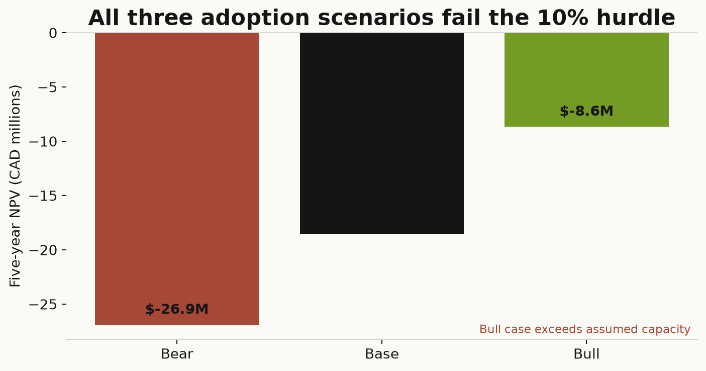

# 5G Network Expansion Investment Analysis

### A CAD $50M network build that fails the five-year investment hurdle

**Recommendation: defer the full build and investigate a shared or smaller deployment.**

This independent case study evaluates a fictional Canadian telecom provider's expansion into an underserved regional cluster. It combines a formula-driven Excel investment model, independently calculated Python analysis, sourced market context and an investment committee recommendation.

> **Hypothetical portfolio case.** Neither the company nor the regional footprint represents an actual Bell project. The work is not affiliated with or endorsed by Bell Canada. All operating forecasts are illustrative.

## Read the decision in two minutes

Start with the [seven-slide executive presentation](presentation/executive_recommendation.pdf), then the [strategy report](documentation/strategy_report.pdf). Open the [Excel financial model](models/5G_Investment_Financial_Model.xlsx) to challenge an input.

| Expanded base case | Result |
|---|---:|
| Initial network CAPEX | CAD $50.00M |
| Total initial cash outflow, including acquisition | CAD $53.49M |
| Five-year incremental revenue | CAD $111.75M |
| NPV at 10% | **CAD $(18.50)M** |
| IRR | **-3.20%** |
| Five-year cash ROI | -10.51% |
| Payback / discounted payback | Neither within five years |
| Undiscounted total cost of ownership | CAD $107.83M |

The initial teaching model produces **CAD $15.05M NPV** because it excludes taxes, customer acquisition, maintenance CAPEX and working capital, and treats all subscription revenue as incremental. The expanded model removes those omissions. These are two different scopes, not conflicting calculations.



| Adoption scenario | Net annual growth | Five-year NPV | Year 5 closing subscribers |
|---|---:|---:|---:|
| Bear | 5% | CAD $(26.90)M | 31,129 |
| Base | 15% | CAD $(18.50)M | 46,776 |
| Bull | 25% | CAD $(8.65)M | **67,817** |

The bull case exceeds the illustrative **60,000-line capacity**. Its result excludes the additional cost of resolving that constraint.

## What changes the decision?

- Network CAPEX must fall to about **CAD $31.02M** for five-year NPV to reach zero, holding other assumptions constant. This is a threshold, not a supplier quote.
- Raising monthly ARPU alone requires about **CAD $85.11**, versus the starting assumption of $65.
- Raising Year 1 average customers alone requires about **33,624**, implying **62,911** closing subscribers in Year 5. That exceeds the current capacity assumption.
- About **CAD $29.80M of net cash value at Year 5** would close the base NPV gap. No such proceeds are supported by the evidence. Zero terminal value is a screening convention, not an estimate of lifetime network value.

The proposed next step is to obtain sharing and reuse quotes, validate local willingness to pay, and rebuild the engineering scope. A CAD $27.5M build is a modeled alternative, not an approved budget or a demonstrated procurement outcome.

## Method and evidence

The analysis follows subscribers through average, opening and closing balances, separates transferred revenue from incremental revenue, and models acquisition spending, network OPEX, depreciation, tax losses, working capital and capital investment. It discounts Year 1-5 unlevered cash flows at 10% and records initial spending at Year 0.

Market evidence comes from [CRTC's 2026 Canadian Telecommunications Market Report](https://crtc.gc.ca/eng/publications/reports/PolicyMonitoring/2026/ctmr.htm), [BCE's 2025 Annual Financial Report](https://www.bce.ca/cs-assets/2025-bce-annual-financial-report.pdf-blt5d552f866d8a58a3) and ISED's published antenna-siting material. Sources provide context, not proof of this fictional region's demand. Publication dates, observation years and limitations are in [the source register](data/sources.md).

## Use the workbook

1. Start on **Dashboard**.
2. On **Assumptions**, set **B14 = 2** for the expanded model or **1** for the simplified teaching model.
3. Set **B15 = 1, 2 or 3** for bear, base or bull. The same live forecast updates throughout the workbook.
4. Blue numerical inputs on amber fill are editable. Black formulas calculate within a sheet. Green formulas link across sheets.
5. The **Sensitivity** tab contains a native two-input What-If Data Table. Keep its temporary override cells blank and enable automatic calculation including Data Tables in Excel.
6. **Scenarios** contains labeled captures from the same forecast. A visible warning marks them stale after economic assumptions change. The live Dashboard and Investment Evaluation still update. Refresh comparison captures with the workbook builder, or recompute the public scenario CSVs in Python.

The workbook has a fixed five-year schedule. Do not extend the horizon merely by changing B3. Any terminal proceeds must be cash net of disposal taxes and fees. The default assumes continued operation and no working capital release at the five-year cutoff.

## Reproduce the calculations

Requires Python 3.10+ and a local Excel application for workbook interaction. From this directory:

```bash
python -m venv .venv
source .venv/bin/activate
python -m pip install -r requirements.txt
python analysis/run_analysis.py --validate-excel
python -m unittest discover -s tests -v
```

Open [the executed notebook](analysis/investment_analysis.ipynb) in Jupyter or VS Code. It imports the documented assumptions, explains the calculations, checks Excel results and displays the evidence.

The public Python workflow regenerates financial tables and charts from `data/assumptions.csv`. `--validate-excel` compares against the separately calculated Excel export captured at workbook build time. It **does not launch Excel**. If you edit Excel or the CSV, the captured comparison is no longer a fresh engine validation. Use `python analysis/read_workbook_inputs.py` to export the workbook's edited inputs for comparison, and rebuild/recalculate the workbook before reporting a new reconciliation. The dated PDFs and narrative require review after assumption changes.

The optional workbook/deck authoring scripts use Codex's bundled `@oai/artifact-tool`. That package is not required to reproduce financial calculations in Python. Authoring setup and regeneration order are in [reproduction notes](documentation/reproduction.md).

## Repository navigation

| Location | Contents |
|---|---|
| `models/` | Interactive, formula-driven Excel workbook |
| `analysis/` | Executed notebook, readable financial engine and analysis runner |
| `data/` | Initial assumptions, source register and sourced contextual observations |
| `outputs/` | Scenario tables, annual forecasts, sensitivity outputs, simulation and reconciliation evidence |
| `outputs/charts/` | Eight charts as PNG and editable SVG |
| `presentation/` | Executive presentation as PDF and editable PowerPoint |
| `documentation/` | Strategy report, methodology, limitations, roadmap, KPI framework and interview preparation |
| `scripts/` | Workbook and presentation authoring source |
| `tests/` | Eight tests of financial logic and timing |

## Validation and limitations

The delivered baseline reconciles **279 principal checks and 49 sensitivity combinations**, with differences far below one cent. Tests cover cash-flow timing, subscriber balances, churn, tax losses, noncash depreciation, undefined returns and break-even thresholds. Workbook renders and every report/deck page receive visual review. Calculation checks use Artifact Tool's Excel-formula engine; this is not a claim of testing in Microsoft Excel desktop.

The model does not establish operational feasibility, local demand, spectrum availability or an actual cost of capital. It assumes a demanding prelaunch subscriber base, simplified tax treatment and limited OPEX scaling. Forecasts exceeding capacity require additional engineering and costs. Monte Carlo input distributions are illustrative and independent; simulated shares are not empirical probabilities of investment success.

## Design credit

The editorial lime-and-black design adapts [SlidesCarnival's Financial Management for Small Businesses Consulting template](https://www.slidescarnival.com/template/financial-management-for-small-businesses-consulting/155244), licensed under [CC BY 4.0](https://creativecommons.org/licenses/by/4.0/). The layout, typography and content were adapted for this case. No template photographs are redistributed. See [design provenance](documentation/design_provenance.md).
